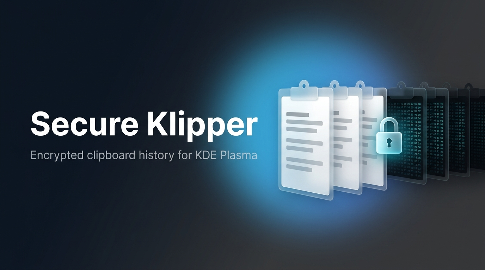
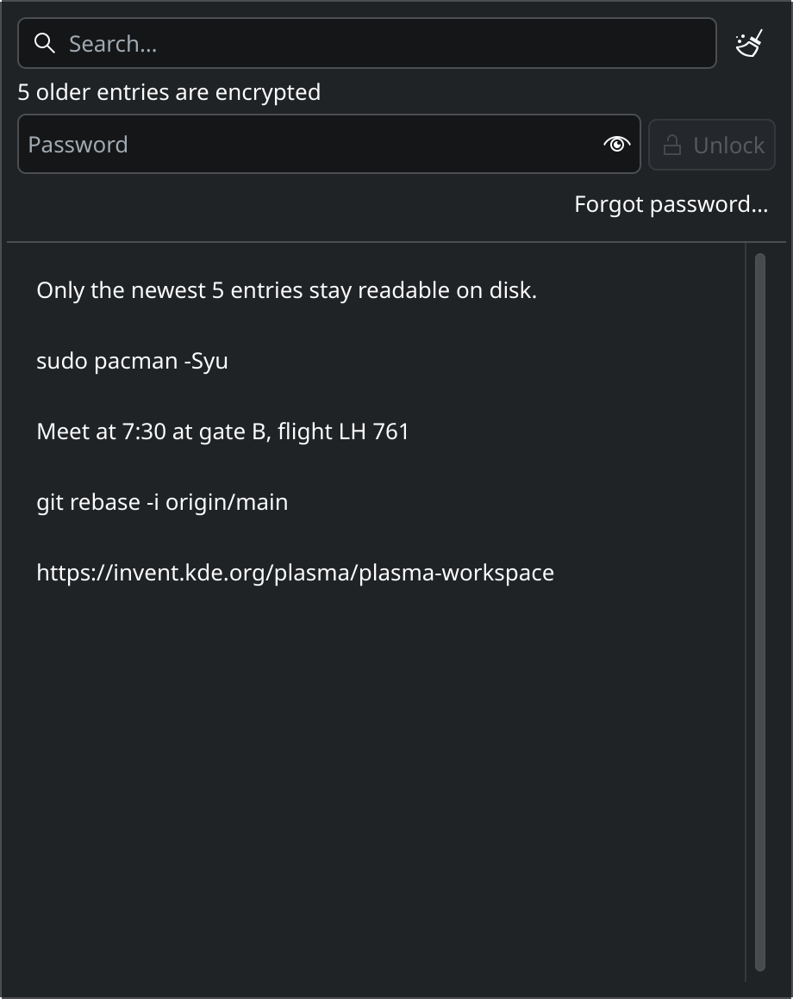
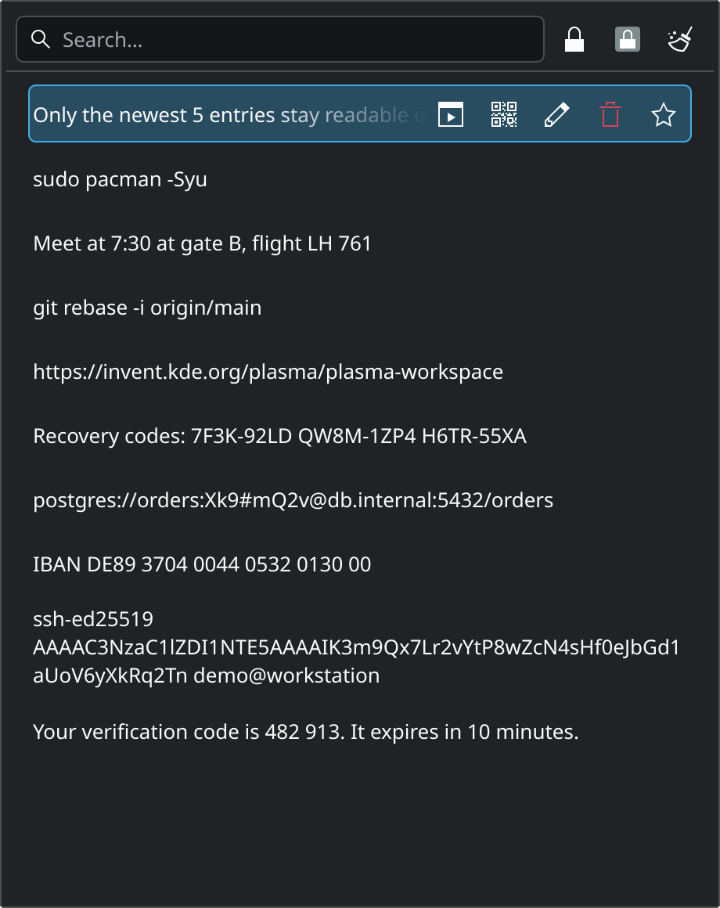
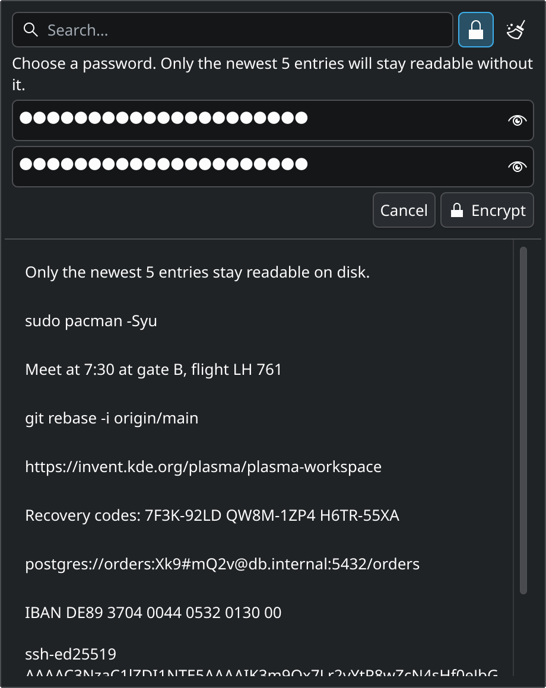
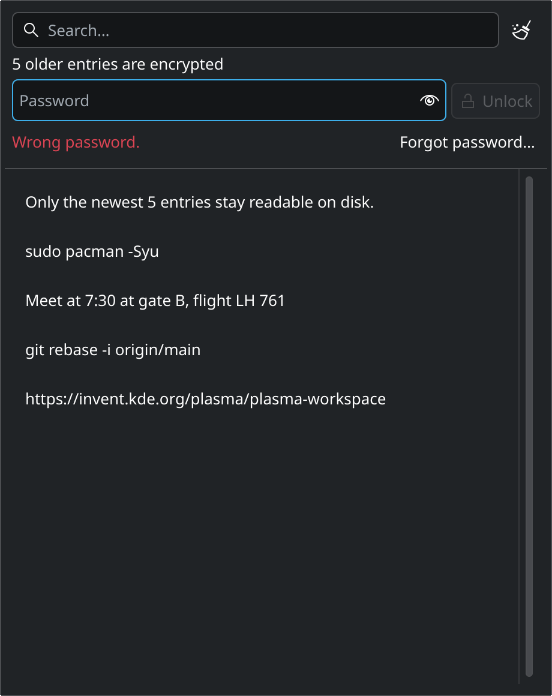

<p align="center">
  
</p>

<p align="center">
  <a href="LICENSES/GPL-2.0-or-later.txt"></a>
  
  
  
  
</p>

<p align="center">
  <b>Your clipboard history remembers your passwords, tokens and recovery codes.<br>
  Secure Klipper keeps only the newest few entries readable and encrypts the rest on disk.</b>
</p>

---

**Secure Klipper** is a fork of [Klipper](https://invent.kde.org/plasma/plasma-workspace/-/tree/master/klipper), the clipboard manager built into KDE Plasma, with password-protected history:

- 🔐 **Only the newest 5 entries stay plaintext.** When an entry ages out of the top 5, it is encrypted on disk straight away, even while the vault is locked.
- 🔑 **One password unlocks the rest,** typed directly into the clipboard popup. Nothing changes about how you copy and paste.
- 🧹 **Old plaintext is really removed,** not just marked deleted. The tests scan every byte of the database, its write-ahead log and the payload files.
- 🔒 **Locks itself:** after 10 minutes, when the screen locks, and on every restart.
- 🧩 **Runs next to stock Klipper.** It installs as its own tray entry in your home folder, with no root and no system files touched, and uninstalls with one script.

## Screenshots

<table>
  <tr>
    <td align="center" width="50%"><br><sub><b>Locked.</b> Only the newest 5 entries are visible. The rest wait behind the password.</sub></td>
    <td align="center" width="50%"><br><sub><b>Unlocked.</b> Older entries are decrypted in memory only and marked with a padlock.</sub></td>
  </tr>
  <tr>
    <td align="center"><br><sub><b>Setup.</b> Turn it on from the padlock button next to the search field.</sub></td>
    <td align="center"><br><sub><b>Wrong password.</b> Unlocking takes about a second on purpose (Argon2id).</sub></td>
  </tr>
</table>

<sub>Screenshots are rendered from the real QML popup with sample data by <code>scripts/screenshots.sh</code>.</sub>

## How it works

```
                  copy ──▶ newest 5 entries ─────────── plaintext, as in stock Klipper
                                  │ ages out
                                  ▼
               sealed to the vault's public key ──────── works while locked: no password needed
                                  │
       password ──Argon2id──▶ unwraps the secret key ─── only on unlock; decrypted in memory only
```

- **Public-key sealing at the top.** Entries must be encrypted the moment they age out, usually while the vault is locked. Each entry gets a random key, which is sealed to an X25519 public key (`crypto_box_seal`). Encrypting needs only the public key; decrypting needs the secret key, which is stored wrapped under your password.
- **Argon2id password hashing** (libsodium `MODERATE`: 256 MiB, ~1 s) makes every offline guess against a stolen database expensive.
- **Authenticated encryption everywhere.** XChaCha20-Poly1305, with associated data that binds each blob to its row and purpose, so blobs can't be swapped between entries. The wrapped key is bound to the public key and the KDF parameters, so a planted public key is detected.
- **No content fingerprints.** Stock Klipper names entries by the SHA-1 of their content, which would let anyone with the database confirm a guess. Encrypted entries get a random id instead.
- **Plaintext is wiped from the files,** not only from the table. The tool uses SQLite `secure_delete`, truncates the WAL after every batch, runs `VACUUM` on clear, deletes payload folders and keeps the files owner-only (`0700`/`0600`).
- **Changing the password is instant.** Only the wrapped key is re-encrypted; entries are not.

The full design, the threat model and what is *not* protected are in **[docs/SECURITY.md](docs/SECURITY.md)**.

## Install

Secure Klipper builds against the KDE Plasma 6.7 / KDE Frameworks 6 already on your system and installs into your home folder. It is tested on Arch Linux with Plasma 6.7.5.

### 1. Dependencies

You need a C++ toolchain, CMake, extra-cmake-modules, the Qt 6 / KF6 / Plasma development files and **libsodium ≥ 1.0.18**.

<details>
<summary>Arch Linux</summary>

```sh
sudo pacman -S --needed base-devel cmake extra-cmake-modules libsodium \
  qt6-base qt6-declarative qt6-wayland kconfig kcoreaddons kguiaddons kglobalaccel \
  ki18n kiconthemes kio knotifications prison kservice kwidgetsaddons kwindowsystem \
  kxmlgui libplasma kwayland layer-shell-qt wayland zlib libxcb plasma-workspace \
  xorg-server-xvfb
```

On Arch the headers ship with the regular packages. `xorg-server-xvfb` is only needed to run the tests.
</details>

<details>
<summary>Other distributions</summary>

Install the development packages for the same list, for example `libsodium-dev`, `extra-cmake-modules`, `libkf6*-dev`, `libplasma-dev` and `plasma-workspace-dev` on Debian/Ubuntu. If CMake stops at a missing package, its message names the package to add.
</details>

### 2. Build, install, uninstall

```sh
git clone https://github.com/giri256/secure-klipper.git
cd secure-klipper

scripts/build.sh       # ~8–9 minutes from scratch on 4 cores; output in build-tray/
scripts/install.sh     # no root; restarts plasmashell (panels blink once)
```

A padlock icon, **Secure Klipper**, appears in the system tray next to the normal clipboard. If it's hidden, go to right-click tray → *Configure System Tray* → *Entries* → *Secure Klipper* → *Always shown*. Open it and click the padlock next to the search field to choose a password.

To remove it:

```sh
scripts/uninstall.sh            # removes the program and tray entry, keeps your encrypted history
scripts/uninstall.sh --purge    # also deletes ~/.local/share/klipper-vault
```

### What gets installed

| Path | Purpose |
|---|---|
| `~/.local/opt/klipper-vault/` | The renamed QML module (the code) |
| `~/.local/share/plasma/plasmoids/org.kde.plasma.clipboardvault/` | The tray applet |
| `~/.config/systemd/user/plasma-plasmashell.service.d/klipper-vault.conf` | Points plasmashell at the module (`QML_IMPORT_PATH`) |
| `~/.local/share/klipper-vault/` | Your history: database and payloads, owner-only |
| `~/.config/klippervaultrc` | Settings |

`uninstall.sh` removes the first three, removes the applet from the tray configuration (after saving a backup of `plasma-org.kde.plasma.desktop-appletsrc`) and restarts plasmashell.

### Running next to stock Klipper

The two never share anything. Every name that would otherwise collide inside the one plasmashell process is renamed at build time: the QML module, the SQLite connection, the data folder, the config file, the D-Bus name, the shortcut actions and the image provider. `tests/coexist/run.sh` loads both into one process and checks that each keeps its own database.

| | Stock Klipper | Secure Klipper |
|---|---|---|
| History | `~/.local/share/klipper` | `~/.local/share/klipper-vault` |
| Settings | `klipperrc` | `klippervaultrc` |
| D-Bus | `org.kde.klipper` | `org.kde.klippervault` |
| Shortcuts | Meta+V, Meta+Ctrl+X | None by default. Set them in *System Settings → Shortcuts → plasmashell* (names start with `vault-`) |

Both see every copy. Only Secure Klipper encrypts its older entries, so you may want to set stock Klipper's history size to a small number, or disable its tray entry. "Prevent empty clipboard" is off in Secure Klipper so the two don't fight over the clipboard.

## Usage

| Action | How |
|---|---|
| Turn on encryption | Padlock button next to the search field → choose a password (8+ characters) |
| Unlock | Type the password in the bar at the top of the popup |
| Lock now | Padlock button (when unlocked) |
| Change password | Key button next to the padlock (when unlocked) |
| Forgot password | *Forgot password…* → *Delete encrypted entries*. Without the password nothing can be recovered |

Settings (in `~/.config/klippervaultrc`, `[General]`):

| Key | Default | Meaning |
|---|---|---|
| `PlaintextHistoryItems` | `5` | How many of the newest entries stay unencrypted (1–100) |
| `VaultAutoLockMinutes` | `10` | Lock this long after unlocking; `0` = only lock on screen lock and restart |

Encrypted entries can't be edited, are never returned by Klipper's D-Bus history API, and the history cycler stops at them while locked.

## Development

```sh
scripts/test.sh                        # builds build/ and runs the 7 autotests in Xvfb with a throwaway HOME
scripts/test.sh -R HistoryVault -V     # one test, verbose
tests/coexist/run.sh                   # stock + Secure Klipper in one process (needs scripts/build.sh first)
scripts/screenshots.sh                 # regenerates docs/images/*.png
```

The tests never touch your real history or clipboard. `historyvaulttest` sets up a vault, ages entries out, then reads every byte of every file in the history folder. It asserts that no older text and no content hash appears anywhere. Disabling the WAL truncation makes it fail, which shows the scan really catches leaks.

### Repository layout

| Path | What |
|---|---|
| `klipper/` | Klipper from plasma-workspace v6.7.5, plus the vault (`historyvault.*`, `historymodel.*`, `declarative/qml/VaultBar.qml`) |
| `applets/clipboard/` | The upstream tray applet the Secure Klipper applet is generated from |
| `scripts/` | `build.sh` (rename + build), `install.sh`, `uninstall.sh`, `test.sh`, `screenshots.sh` |
| `tests/coexist/` | Stock and Secure Klipper loaded side by side |
| `patches/secure-klipper-6.7.5.patch` | All changes as a patch series against upstream `v6.7.5`, for distributions or a system-wide build |
| `patches/demo-history-5000.patch` | Optional, unrelated: raises the history limit from 2048 to 5000 |
| `cmake/`, `CMakeLists.txt`, `c_ptr.h`, `config-X11.h.cmake` | Minimal build wrapper around the upstream sources |

The first commit (tag `upstream-v6.7.5`) is an unmodified import of upstream, so `git diff upstream-v6.7.5 -- klipper` shows exactly what changed.

## Quality-of-life fixes included

- Shrinking or clearing a large history is fast. Upstream issued one SQL statement and one KIO job per row, taking ~67 s to drop 4980 entries and ~135 s to clear 5000.
- The history folder and database are created owner-only. Upstream follows the umask, so the files are usually world-readable.
- "Clear history" really removes the bytes from the database files.

## Limitations

- **Metadata isn't hidden:** the number of entries, their timestamps, which are starred and their approximate sizes.
- **The newest entries are plaintext by design,** and the current clipboard is readable by any running app, as always.
- **It doesn't protect against malware running as you.** That includes reading plasmashell's memory while the vault is unlocked, or logging the password as you type it. The goal is encryption at rest: stolen disks, backups, synced home folders, other local users.
- **Copy-on-write filesystems and SSDs** may keep old blocks after a file is rewritten. Use full-disk encryption as well.

See [docs/SECURITY.md](docs/SECURITY.md) for the details.

## Credits and license

Secure Klipper is built on **Klipper** by the KDE community. All upstream code keeps its original authors and licences (see the SPDX headers and `LICENSES/`). The encrypted-history additions are © 2026 giri256 and licensed **GPL-2.0-or-later**, like Klipper itself.

This is an independent project and isn't affiliated with or endorsed by KDE e.V. If you're a KDE developer and want any of this upstream, issues and merge requests are welcome.
